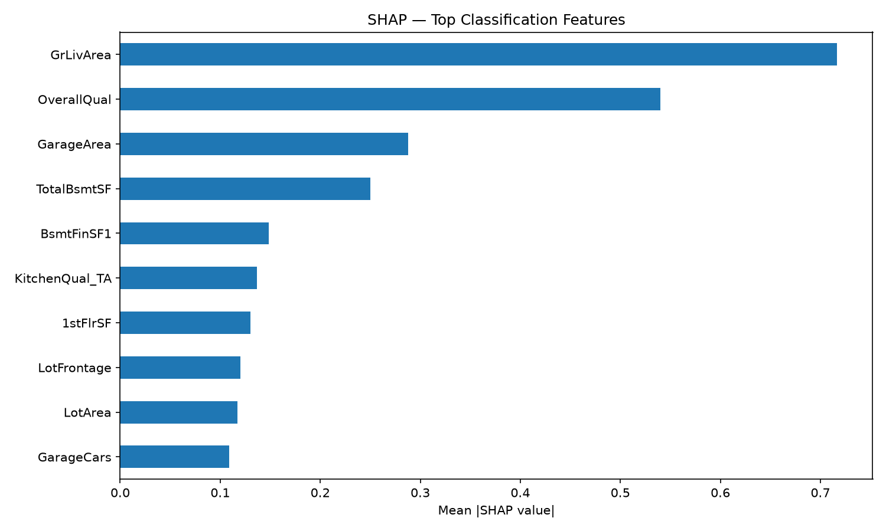
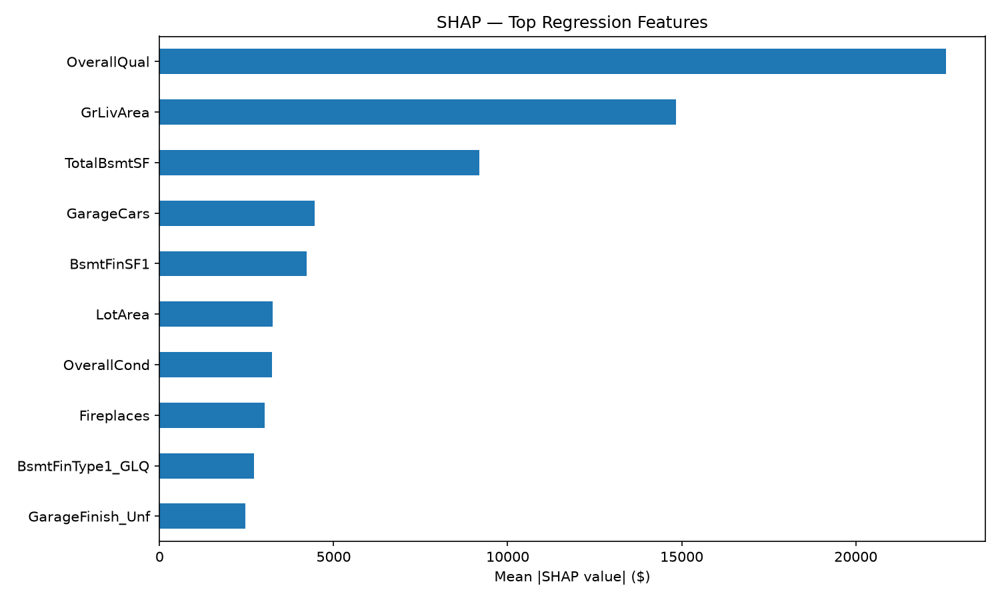

# Real Estate ML — Property Tier Classification & Price Prediction

An end-to-end Machine Learning system that classifies properties into investment tiers (Budget / Mid-Range / Premium) and predicts sale prices, built on the Ames Housing dataset.

## Business Problem

Real estate investors need quick, data-driven assessments of properties. This system provides:
- **Classification**: Which investment tier does this property belong to?
- **Regression**: What is the estimated sale price?

## Results

| Task | Model | Metric | Score |
|------|-------|--------|-------|
| Classification | XGBoost | CV F1 (macro) | 0.845 ± 0.023 |
| Classification | Random Forest | CV F1 (macro) | 0.832 ± 0.024 |
| Regression | XGBoost | CV R² | 0.902 ± 0.025 |
| Regression | ElasticNet | CV R² | 0.898 ± 0.022 |

## Project Structure

real-estate-ml/
├── src/ # Core ML code
│ ├── config.py # Central configuration
│ ├── data_validation.py # Schema and range checks
│ ├── feature_engineering.py # Domain-driven features
│ ├── preprocessing.py # sklearn ColumnTransformer pipeline
│ ├── train.py # Training + MLflow tracking
│ └── evaluate.py # Metrics + SHAP explainability
├── api/ # FastAPI prediction service
│ ├── app.py # API endpoints
│ └── schemas.py # Pydantic request/response models
├── tests/ # Automated tests
│ ├── test_features.py # Feature engineering tests
│ └── test_api.py # API endpoint tests
├── notebooks/
│ └── 01_eda.ipynb # Exploratory Data Analysis
├── models/ # Saved model artifacts (gitignored)
├── plots/ # SHAP and evaluation plots
├── Dockerfile # Container for the API
├── requirements.txt # Python dependencies
└── .github/workflows/ci.yml # CI pipeline


## Architecture

Raw CSV
→ Data Validation (schema + range checks)
→ Feature Engineering (6 domain features + 3-tier target)
→ Preprocessing (ColumnTransformer: impute → encode → scale)
→ Training (RF + XGBoost classifiers, ElasticNet + XGBoost regressors)
→ MLflow Experiment Tracking
→ Model Evaluation + SHAP Explainability
→ FastAPI Prediction Service
→ Docker Container


## Setup

```bash
# Clone the repository
git clone https://github.com/konstantinostraganos/real-estate-ml.git
cd real-estate-ml

# Create virtual environment
python -m venv venv
source venv/bin/activate        # Linux/Mac
venv\Scripts\activate           # Windows

# Install dependencies
pip install -r requirements.txt

# Download dataset
# Place train.csv from Kaggle's "House Prices" competition in data/raw/
```

## Usage

### Train models
```bash
python -m src.train
```

### Evaluate models
```bash
python -m src.evaluate
```

### Run tests
```bash
pytest tests/ -v
```

### Start API locally
```bash
uvicorn api.app:app --reload --host 0.0.0.0 --port 8000
```
Then open http://127.0.0.1:8000/docs

### Run with Docker
```bash
docker build -t real-estate-ml .
docker run -p 8000:8000 real-estate-ml
```

## API Example

```bash
POST /predict
{
    "LotArea": 8450,
    "OverallQual": 7,
    "OverallCond": 5,
    "YearBuilt": 2003,
    "YearRemodAdd": 2003,
    "1stFlrSF": 856,
    "2ndFlrSF": 854,
    "GrLivArea": 1710,
    "FullBath": 2,
    "TotalBsmtSF": 856,
    "GarageCars": 2,
    "GarageArea": 548
}

→ Response:
{
    "property_tier": "Mid-Range",
    "predicted_price": 180546.28
}
```

## Feature Engineering

| Feature | Formula | Business Logic |
|---------|---------|---------------|
| HouseAge | YrSold - YearBuilt | Older properties depreciate |
| HasRemodel | YearRemodAdd ≠ YearBuilt | Remodelled homes sell higher |
| TotalSF | Basement + 1st + 2nd floor | Total size drives value |
| TotalBathrooms | Full + 0.5×Half + Basement | Industry counting convention |
| TotalPorchSF | Sum of all porch areas | Outdoor space adds value |
| QualityScore | OverallQual × OverallCond | Quality-condition interaction |

## Explainability (SHAP)

Top features driving predictions:

**Classification:**



**Regression:**



## Tech Stack

- **Python** — pandas, scikit-learn, XGBoost
- **MLflow** — experiment tracking
- **FastAPI** — prediction API
- **Docker** — containerization
- **pytest** — automated testing
- **GitHub Actions** — CI pipeline